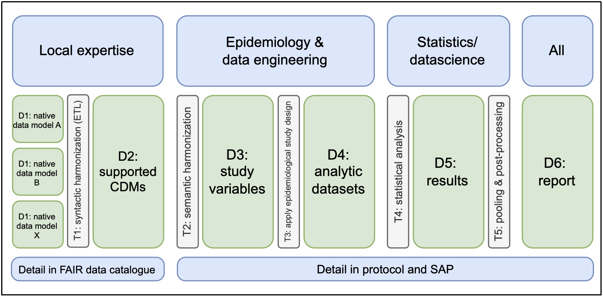

# TARGET-EU CASE STUDY 7: Risk of adverse birth and neurodevelopmental outcomes in children born alive to fathers exposed to valproate versus levetiracetam for generalised epilepsy

This repository contains code which implements [case study 7](https://catalogues.ema.europa.eu/node/4903/administrative-details) of the [TARGET-EU project: Comparative effectiveness and safety studies using the target trial emulation and estimand frameworks](https://catalogues.ema.europa.eu/node/4440/administrative-details). The repository contains the code which implements the study design of this case study, along with documentation of that code, and where feasible, dummy data which allows users to run and understand the code. Below we describe briefly the case study and document the repository and its operation. 

## Background

Multiple studies have suggested that the intake of valproate for pregnant women during pregnancy has a negative effect on pregnancy outcomes (including congenital anomalies and neurodevelopmental disorders (Liu et al., 2023: Tomson et al., 2019: Bromley et al., 2023). The evidence regarding the effect of paternal valproate exposure is much less clear. A study conducted by IQVIA concluded there was an increased risk of neurodevelopmental disorders (IQVIA, 2021). A recent study, using partially the same data, concluded there were no increased risks of neurodevelopmental disorders or congenital malformations (Christiansen at al., 2024). The UK Medicines Agency has recommended further studies about the effect of valproate in the spermatogenic cycle, as well as long-term effects (Medicines & Healthcare products Regulatory Agency, 2023).

Research question: What is the cumulative incidence of death, major congenital malformations, autism and ADHD in offspring born alive to fathers diagnosed with generalised epilepsy exposed to valproate compared to levetiracetam? 

Primary objective: The primary objective is to estimate the cumulative incidence of death, major congenital malformations, ADHD and autism in offspring born alive to fathers diagnosed with generalised epilepsy exposed to valproate compared to levetiracetam. 

### EMA Catalogue Entries
[Catalogue Entry of Case Study](https://catalogues.ema.europa.eu/node/4903/administrative-details)

[Protocol & Report](https://catalogues.ema.europa.eu/node/4903/study-documents)

## Repository 

This repository contains all code necessary to reproduce the results contained in the case study report, that is, the analytic pipeline designed to implement the specific study design. The repository does not contain any real data: The real data remains on secure servers, and only fictitious dummy data is shared here for testing, development and illustration purposes. 

The analytic pipeline is conceptualised as a series of transformations (denoted "T") which transform data objects ("D") to other data objects [Gini et al. 2016](https://pmc.ncbi.nlm.nih.gov/articles/PMC4780748/)



The exact analytic pipeline for this study is represented as a graph containing specific data objects and transformation and their relationships [here](https://github.com/target-roc19/case-study-07-valproate-public/blob/main/docs/cs7_pipeline_diagram.pdf)

Each data object in the pipeline is documented in a corresponding [**codebook**](docs/cs7_pipeline_diagram.pdf) which describes how the data object is obtained from its inputs. Thereby, the codebooks specify the implementation of the given study design, which is executed by the scripts in the repository.


## Repository Structure
```
[case-study-07-valproate]
|____configuration
|____data
| |____D2_cdm
| |____D3_study_variables
| |____D4_analytic_datasets
| |____D5_results
| |____D6_report
|____docs
|____logs
|____run
|____tests
|____transformations
| |____T2_semantic_harmonization
| |____T3_study_design
| |____T4_statistical_analysis
| |____T5_processing_results
|____LICENSE
|____README.md
```

- The `data/D2_cdm` folder contains the base input data, following a Common Data Model (CDM) structure, in this case the [ConcePTION](https://github.com/IMI-ConcePTION/ConceptionTools/wiki) CDM.
- The `transformations` folder contains the scripts which compose the analytic pipeline
- Intermediate data objects created by `transformations` are stored in the other `data` subfolders
- The `docs/codebook` folder contains the study codebooks describing each intermediate data object
- The `transformations/common_configuration/RWE-BRIDGE` folder contains all project metadata, including events, medicines and vaccine codelists used in the study, as well as other metadata files specifying definitions of study concepts and variables. 

### Codelist

The analysis pipeline uses a `codelist` to identify records in the source data relevant to the study objectives. This codelist, its authors, and the appropriate citation has its own DOI: [10.5281/zenodo.21235599](https://zenodo.org/records/21235599)

### Dummy Data
- Test data for a number of intermediate data objects can be found in `tests/testthat/test_data`
- Synthetic CDM will be made publicly available soon, in the mean time available on request from the programming team (below)

## How to Run
1. Store dummy CDM in `data/D2_cdm`
2. Update data path in `configuration/config_project.yaml`, `DEAP_configuration$data_instance`
3. Run the full pipeline with:

```
run/run_pipeline.R
```
Or run specific steps, e.g.:

```
run/run_T2.R
```

- Which parts of the pipeline are executed can be configured through `configuration/config_pipeline.yaml`
- More specifically which scripts are executed in each part can be configured through `configuration/config_TX.yaml`.
- `config_project.yaml` defines which objects along which paths are used as inputs to different scripts in the pipeline, including the input CDM instance.

## Testing
Run tests with:

```
testthat::test_dir("tests")
```

## License
See [License](https://github.com/target-roc19/case-study-07-valproate-public/blob/main/LICENSE.txt)

## Open Science Badges
<a href='https://doi.org/10.25937/krp4-g724'>

</a>

## Contact
For questions or support, contact:
- Case Study Lead
    - Name: Carlos González Poses
    - Email: c.gonzalezposes-2@umcutrecht.nl
    - Name: Linda Nab
    - Email: l.nab@umcutrecht.nl
- Lead Programmers
    - Name: Sebastian Mildiner Moraga
    - Email: S.MildinerMoraga@umcutrecht.nl
    - Name: Carlos González Poses
    - Email: c.gonzalezposes-2@umcutrecht.nl
- Programming Team
    - Name: University Medical Center Utrecht
    - Email: wp2.targeteu@umcutrecht.nl
